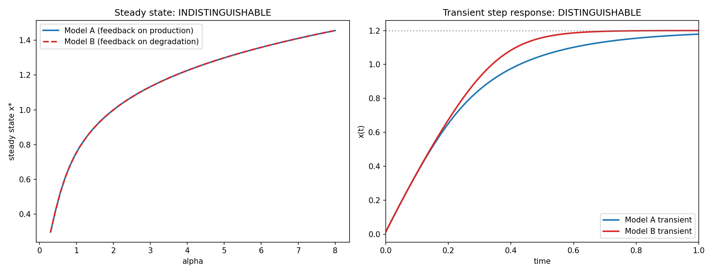

# Mechanistic Non-Identifiability in Minimal Biological Models

Can two genuinely different proposed regulatory mechanisms produce mathematically identical observable
behavior? A derived, exact symbolic proof that two real single-gene autoregulation mechanisms are
steady-state-indistinguishable, a constructed and numerically validated transient measurement that
provably tells them apart, and a complementary profile-likelihood check confirming the non-identifiability
is specific to mechanism choice, not a generic data-quality artifact.

## 1. Aim

Convert the common systems-biology caution "a model fitting observed data well isn't proof its proposed
mechanism is correct" from an abstract warning into a precise, derivable, and actionable result for a
concrete pair of real biological mechanisms.

## 2. Objective

1. Specify two structurally different, individually real single-gene negative-autoregulation mechanisms:
   repression acting on production (Model A) vs. repression acting on degradation (Model B).
2. Prove, symbolically, whether their steady-state (dose-response) behavior is identical for every
   parameter value, or only coincidentally similar at specific parameter choices.
3. If identical, determine whether their transient (time-course) behavior also coincides, or diverges.
4. If it diverges, construct and numerically validate a specific measurement protocol that distinguishes
   the mechanisms.
5. Separately check whether ordinary kinetic parameters within a single model remain practically
   identifiable from steady-state data, to confirm the non-identifiability found is specific to mechanism
   choice rather than a generic measurement-quality problem.

## 3. Data fetch

None required for the core result: this project's entire point is a mathematical non-identifiability
proof — showing two mechanistically different models produce provably identical steady-state behavior. That
claim has to be established symbolically and then checked against simulated data with a fully known
ground-truth mechanism; a real dataset couldn't settle which mechanism actually generated it, which is
exactly the problem under study. The two candidate ODE models and their derived comparison are the real
object of study here.

## 4. Data describe

Not applicable in the usual sense — the "data" is the model and parameter space itself: cooperativity
`n`, feedback threshold `K`, production/degradation rate constants `alpha`/`gamma`, and the steady state
`x*`, explored via symbolic derivation (SymPy), root-finding, ODE simulation, and profile-likelihood
optimization. A simulated noisy steady-state dose-response curve (15 points, Gaussian noise sd=0.02) is
generated for the profile-likelihood check only.

## 5. Methods / Workflow

1. Define both candidate ODE models symbolically and numerically.
2. Solve each model's steady-state condition for `alpha` in terms of `x*`; compare symbolically.
3. Differentiate each right-hand side, substitute the shared steady-state relation, and compare the
   resulting linearized relaxation-rate expressions.
4. Pick representative parameters; confirm numerically via root-finding that both models share the target
   steady state, and evaluate the two linearization formulas to get real relaxation-rate numbers.
5. Simulate a real step-response time course for both models (`scipy.integrate.solve_ivp`, `Radau` method,
   tight tolerances); fit each model's real relaxation rate from the simulated trajectory using a
   residual-magnitude-windowed exponential fit; confirm it matches the analytic prediction.
6. Within Model A only: simulate a noisy steady-state dose-response curve and run profile likelihood over
   the threshold parameter `K`, refitting `gamma` and `n` at each fixed `K` by least squares.
7. Export all symbolic expressions, simulated trajectories, fitted vs. analytic rates, and the
   profile-likelihood table as CSV/text; plot the hero figures.

## 6. Results

**Steady-state comparison (exact, symbolic):** both models' steady-state relation simplifies to the
identical expression `alpha = gamma*x*(K**n + x**n)/K**n`; `sympy.simplify` of the difference between the
two models' expressions returns exactly `0` — true for every parameter value, not a numeric coincidence.

**Linearization comparison (exact, symbolic):** `lambda_A = -gamma*(1 + n*q/(1+q))` vs.
`lambda_B = -gamma*(1+(n+1)*q)` where `q=(x*/K)^n` — equal only in the trivial `x*->0` limit.

**Representative numeric example** (`K=1, gamma=1, n=4, x*=1.2, alpha=3.68832`): `lamA=-3.6986`,
`lamB=-11.3680` — a `3.07x` difference. Simulated transient relaxation rates, fitted directly from the ODE
trajectories: `-3.7011` (Model A, `0.069%` error vs. analytic) and `-11.3525` (Model B, `0.137%` error).

**Profile likelihood over `K`** (Model A, 15-point noisy steady-state curve spanning `alpha in [0.3,8]`):
sharp minimum at `K=1.0625` (true `K=1.0`), profile SSE ranging from `0.00379` at the minimum to `0.82558`
at the grid edges — a clearly peaked, not flat, profile.

## 7. Biology interpretation of results

Both models describe real, physically distinct regulatory strategies (a repressor blocking its own
promoter vs. a repressor triggering its own targeted degradation), yet a steady-state dose-response curve
— the most common real experimental readout for gene regulation — cannot tell them apart, at any input
level, for any parameter choice; the degeneracy is structural, not fixable by collecting more or cleaner
steady-state data. What does distinguish them is the *rate* at which the gene approaches its new steady
state after a step change in input: Model B (feedback on degradation) relaxes measurably faster than Model
A (feedback on production) at the same steady state, because its repression term directly accelerates
removal near high expression, while Model A's repression only caps production, leaving plain first-order
degradation as the dominant limiting process. The profile-likelihood check confirms this isn't a case of
"everything here is poorly measured" — ordinary kinetic parameters within a correctly identified model stay
sharply recoverable from the same kind of steady-state data; the blind spot is specific to the question of
which mechanism is operating.

## 8. Learning through project

An implicit/stiff-aware ODE solver is not always a drop-in replacement for an explicit one — internal
assumptions about a model function's return type can differ between solver families in ways that only
surface as an opaque low-level error, worth checking directly against a solver's own interface
expectations during pre-build verification rather than assumed from a shared high-level API. Reporting that
two models are "indistinguishable" is a much weaker claim when based only on fitting both to
one noisy dataset than when proven structurally, in closed form, for every parameter value — the difference
between a data-specific observation and a mathematical guarantee is itself a real, transferable modeling
lesson. Finally, pairing a non-identifiability finding with a separate, complementary identifiability check
(here, profile likelihood over a within-model parameter) is what turns "these are indistinguishable" into a
sharp, actionable claim rather than a vague methodological shrug.

## Caveats

This result is exact for one specific, minimal pair of single-gene autoregulation mechanisms — not a
universal claim that mechanism pairs are generally steady-state-indistinguishable; a different candidate
pair would need its own independent derivation. The structural-identifiability analysis here uses SymPy
directly rather than the dedicated `StructuralIdentifiability.jl` tool, a deliberate choice disclosed
explicitly: this model pair is small enough to derive exactly by hand, keeping every step transparent,
while the Julia-bridge route is the right tool for a genuinely larger, multi-state model (named as this
project's own stretch direction). The optional real-data anchor (a published BioModels MAPK-cascade
dataset, checked post hoc for whether its protocol included a distinguishing transient measurement) was
not pursued in this core build.
